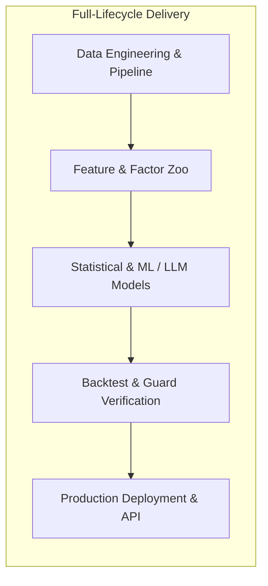

# Hi there, I'm Shen He (沈鹤) 👋

  
  
  
  
  
  
  
  

---

## 🎯 Profile Overview

- 🎓 **Education**: Jiangnan University (江南大学 · 211工程) — Big Data Management and Application (大数据管理与应用)
- 💼 **Target Role**: **ByteDance (字节跳动) · AI算法 / 机器学习系统 / 量化工程实习生**
- 🔬 **Core Focus**:
  - **Machine Learning & Quantitative Modeling**: Alpha factor engineering (50+ factors), Conformal Risk prediction (CQR), TreeSHAP 2nd-order interaction analysis, monotonic business constraint modeling.
  - **LLM Application & RAG Systems**: Dense-sparse hybrid search (BM25 + ChromaDB), citation tracking, answerability verification, and token budget management.
  - **Production ML Systems & Rigor**: Deterministic engineering gates (Git pre-commit defenses, zero silent failures), realistic backtesting (stamp duty, commission, slippage), and high-reliability API microservices.

---

## 🌟 Featured Open-Source Repositories

| Repository | Tech Stack | Highlights |
|:---|:---|:---|
| **[QuantFlow](https://github.com/shencangsheng513/QuantFlow)** | Python, PyTorch, LightGBM, Flask, Conformal Prediction | **Production-grade Quantitative ML & Realistic Backtesting Engine** • 50+ alpha features (momentum, volatility, money flow, technical) • Soft-routing Mixture of Experts (MoE) & Conformal Risk (CQR 95% corridor) • Realistic backtest with slippage & commission (8.17% out-of-sample return) • 140+ unit & integration tests with 100% pass rate |
| **[scientific-xai-suite](https://github.com/shencangsheng513/scientific-xai-suite)** | Python, XGBoost, CatBoost, SHAP, Optuna | **Publication-Grade Interpretable ML & Credit Risk Modeling Suite** • TreeSHAP 2nd-order interaction matrix & Centred ICE (c-ICE) heterogeneity analysis • Credit Risk Scorecard with Weight of Evidence (WOE) & Information Value (IV) • Monotonic business constraint auditor & Decision Curve Analysis (DCA) • Interactive web visualization showcase |
| **[financial-rag-engine](https://github.com/shencangsheng513/financial-rag-engine)** | Python, ChromaDB, BM25, Flask, BAAI/bge-small-zh | **Enterprise Financial RAG Engine with Citation & Hallucination Guard** • Dense-sparse hybrid retrieval combining BAAI/bge-small-zh embeddings with BM25 • Dynamic cross-encoder reranker with answerability threshold evaluation • Generation token budgeting guard and strict citation symbol verification • 34+ unit tests passing |
| **[news-classifier-service](https://github.com/shencangsheng513/news-classifier-service)** | Python, FastAPI, Docker, Render, Scikit-learn | **Live Production ML Inference Microservice (Cloud Deployed)** • End-to-end containerized text classification service with live demo on Render • Bearer token authentication middleware with zero-token probe paths (`/healthz`, `/ready`) • Full Swagger API documentation and latency profiling (~180ms cloud cold, <25ms local) • Direct Dockerfile recipe with pinned scikit-learn environment |
| **[ml-tutorial](https://github.com/shencangsheng513/ml-tutorial)** | Python, Scikit-learn, PyTorch, MLflow, FastAPI | **Hands-on End-to-End ML Engineering Lab Portfolio** • 4 full-stack projects + 6 engineering labs • FastAPI production deployment with latency benchmarking (<20ms) • Multi-round scientific RAG ablation experiments with hypothesis testing • Model distillation & compression experiments |

---

## 🛠️ Tech Stack & Architecture

- **Languages**: Python (Proficient), SQL, TypeScript/JavaScript, Bash/PowerShell
- **ML & Data**: PyTorch, LightGBM, XGBoost, CatBoost, Scikit-Learn, SHAP, Optuna, NumPy, Pandas, PyArrow
- **LLM & RAG**: ChromaDB, BM25, Vector Search, Embedding Models, Hybrid Retrieval
- **Web & Backend**: FastAPI, Flask, Pydantic, SQLAlchemy, PyMySQL, RESTful APIs, Docker

---

## 📬 Contact & Links

- 📧 **Email**: 2273899131@qq.com
- 💻 **GitHub**: [github.com/shencangsheng513](https://github.com/shencangsheng513)
- 📍 **Location**: Wuxi / Shenyang, China
